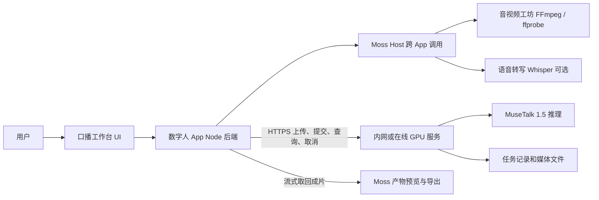

# 真人口播工作台 v0.1 方案

首版在 Moss 市场独立发布 `moss.digital-human`。用户导入单人真人模板视频与配音，使用 MuseTalk 1.5 生成同步口型，预览并导出 MP4。已配置 TTS 的用户也可以从讲稿生成配音并试听。首轮从 **单台 Apple Silicon Mac** 开始验证，按是否需要本机离线出片选择推理路径。

## 单台 Mac 的部署选择

- **可以联网**。Mac 安装口播工作台和音视频工坊，推理由托管 GPU 服务完成。首版继续使用 MuseTalk 1.5 的上游 CUDA 推理路线，客户端仅下载自己的 App 包和缺少的 App 依赖。Linux GPU 介质由服务部署方使用。[MuseTalk 安装说明](https://github.com/TMElyralab/MuseTalk#installation)
- **需要完全本机离线**。先验证 MuseTalk 1.5 的 Apple Silicon 社区移植。`musetalk-mlx` 提供从模板视频和音频输出本地 MP4 的命令，公开的性能数据来自 M5 Max。`musetalk-mac` 使用 PyTorch MPS，项目说明需约 4 GB 权重，给出的推理测试来自 M3 Ultra。对 M1 和 8 GB 统一内存的组合，先跑单个 5–10 秒普通话样片，测峰值内存、交换空间、磁盘占用和出片时间，再决定是否作为本机发行引擎。通过后把已校验的 macOS 运行时、依赖和权重随离线介质交付，按实际构建重新计量包体。[MuseTalk MLX 移植](https://github.com/dahai80/musetalk-mlx) · [MuseTalk MPS 移植](https://github.com/barnent1/musetalk-mac)

客户端离线安装和本机离线推理分别验收。现有 **33–36 MiB** 预算对应基础客户端整包，**7–12 GiB** 对应原方案中独立部署的 Linux GPU 服务介质。

## 整体架构（GPU 服务路径）



1. 用户选择或复用有权使用的真人视频模板，导入 WAV、MP3 等配音。数字人 App 通过 `moss.media-tools` 的 `run` 和 `task` 读取媒体元数据。首版 UI 覆盖模板、配音、任务状态、出片预览和导出。上传配音可以直接完成整个流程。[音视频工坊工具](../apps/media-tools/app.moss.json#L113)
2. Node 后端用 HTTPS 流式上传模板和音轨，提交异步任务并保存任务 ID。在设置中配置推理地址和访问凭据。服务端对同一模板内容和预处理参数缓存人脸区域及模型所需特征，换配音时可以复用。首版 GPU 服务使用单卡工作进程、SQLite 任务队列和挂载目录。提交支持幂等重试，服务重启后可以查询已有任务。[MuseTalk 1.5 项目](https://github.com/TMElyralab/MuseTalk)
3. 后端拉取成片，通过音视频工坊完成 H.264/AAC MP4 转码。跨 App 调用只传任务参数、ID 和产物 URL，媒体文件通过流传输并复制到数字人 App 的任务目录，供预览、导出和历史查询使用。用户启用字幕时，调用语音转写生成 SRT/VTT。[跨 App 调用](https://github.com/baiguidong/moss/blob/main/ui/docs/app-capabilities.md) · [音视频任务结果](../packages/engine-apps/src/backend.mjs#L169) · [字幕产物](../apps/transcription/src/backend/engine.mjs#L68)

## 安装包与外部依赖

| 部件 | 首版依赖 | 部署位置与用途 |
| --- | --- | --- |
| `moss.digital-human@0.1.0`（拟定） | 新版 Moss Host、App SDK、Node | 用户电脑。安装包带 UI、Backend、Manifest 和可重建源码，保存模板、设置、任务和产物。 |
| `moss.media-tools@0.1.0` | 必选 App，使用发布版 | 用户电脑。已有 FFmpeg 8.0.1 和 ffprobe 5.0.1，负责探测与最终编码。 |
| `moss.transcription@0.1.4` | 可选 App，按字幕需求安装 | 用户电脑。复用现有 Whisper.cpp、权重和 SRT/VTT 生成能力。 |
| MuseTalk 1.5 推理服务 | 完成出片所需 | Linux x64 NVIDIA 主机。锁定 Python、PyTorch、CUDA/cuDNN、OpenMMLab 组件、FFmpeg，以及 MuseTalk 1.5、SD VAE、Whisper Tiny、DWPose、人脸解析权重。GPU 驱动和容器运行时由目标主机提供。建议以一台 RTX 4090 做首轮验证并据实记录显存、首单耗时和并发。 |
| TTS 服务 | 开启文字转配音时按需接入 | 由部署方配置可访问的服务，断公网场景可配置内网 TTS。上传已有配音即可完成首发流程。 |

服务端的 Whisper Tiny 用于 MuseTalk 音频特征，客户端的 Whisper.cpp 用于识别字幕。两者分别随各自部署介质提供。客户端使用已安装 App 的受管工具，音视频工坊负责编解码。服务端 FFmpeg 随 Linux 推理镜像交付，负责 MuseTalk 的抽帧和音画合成。权重与原生库按文件记录版本、SHA-256 和再分发许可。[上游依赖安装说明](https://github.com/TMElyralab/MuseTalk#installation) · [权重清单](https://github.com/TMElyralab/MuseTalk/blob/main/download_weights.sh) · [上游许可](https://github.com/TMElyralab/MuseTalk#disclaimerlicense)

## 组合安装

每个 App 保持独立发布的签名 ZIP 和版本。拟在签名 Manifest 增加包依赖声明，描述目标 App ID、发布者和是否必选。首版按目标平台由发布记录锁定经过验收的精确版本、文件大小和 SHA-256。`appCapabilities.usesTools` 继续负责具体工具授权。宿主展示本次复用、新装及可选的 App，用户按包审阅新增权限。[现有跨 App 授权](https://github.com/baiguidong/moss/blob/main/ui/docs/app-capabilities.md)

- **在线安装**。Moss 市场生成安装计划，校验平台、版本、签名与已装状态。用可信安装记录匹配到同版依赖时直接复用，缺少的包才下载。若存在版本冲突，界面列出冲突，用户可以查看受影响的 App 后决定如何处理。
- **离线安装**。对照知识库做法，将线上同一批签名 ZIP 原样纳入组合包。组合包使用新版 `offline.json` 格式，清单签名绑定根 App、目标平台和内包的身份、大小及摘要。用户从新版 Moss 选取整包，宿主核对清单、根 App 声明和全部待装内包后再激活，内网目标机无需访问应用市场。基础整包包含音视频工坊，字幕整包另外包含语音转写。[知识库在线与离线交付](app-offline-delivery.md) · [现有离线包签名](../scripts/offline-kit.mjs#L10)
- **安装和更新的一致性**。安装前检查版本冲突、循环依赖、空闲空间及包完整性。暂存齐全后按依赖顺序激活，并记录本次提交的版本与安装修订。取消或激活失败时回退本次变更，保留原有应用、配置和用户数据。卸载根 App 后，公共依赖可供其他 App 继续使用。卸载或升级依赖时，界面展示仍依赖它的 App。[现有安装修订与回滚](https://github.com/baiguidong/moss/blob/main/ui/src/apps/app-runtime-ipc.mjs)

离线整包结构示意。字幕版在 `apps/` 多带一份语音转写 ZIP，并将它纳入同一签名清单。

```text
moss.digital-human-0.1.0-offline-darwin-arm64.zip
├── offline.json
├── offline.sig
├── apps/
│   ├── moss.digital-human-0.1.0-darwin-arm64.zip
│   └── moss.media-tools-0.1.0-darwin-arm64.zip
└── 安装说明.txt
```

知识库现有整包以一个主 App ZIP 加配套资源为交付单位。多 App 清单、依赖解析、离线导入和激活顺序需要 Moss Core 配套更新。`moss-apps` 的发布流程在依赖版本已发布后取回现成签名包，组包、签名并登记市场。完全断公网部署时，客户把 GPU 服务的镜像、锁定权重和校验清单带到 Linux 推理机，再让桌面 App 连接内网地址。[现有单 App 解析](https://github.com/baiguidong/moss/blob/main/ui/src/apps/app-marketplace.mjs) · [离线发布流程](../.github/workflows/release-app.yml#L282)

首版以复用发布包验证组合安装。同一台主机上依赖其他 App 时，音视频工坊按 App 身份复用一次。音视频工坊与语音转写各自随包交付的相同 FFmpeg 文件仍各占一份，后续可以把共同二进制迁入宿主管理的运行时仓，再由多个 App 声明同一摘要。[媒体运行时锁定](../apps/media-tools/resources/engine.json) · [转写运行时锁定](../apps/transcription/resources/ffmpeg.json)

## 体积预算

表内为压缩交付文件大小。市场实包按目录公布的字节数转换为 MiB，数字人新包和 GPU 介质为构建前预算。已有新版 Moss 桌面版作为安装前提，裸机交付时另带对应的 Moss 安装程序。

| 交付项 | 大小 | 依据 |
| --- | ---: | --- |
| 知识库 `0.1.13` | 在线 **0.81 MiB**，离线 **204.17 MiB** | 市场实包。离线介质包含原 App ZIP、Python wheels 和模型。[市场记录](https://baiguidong.github.io/moss-apps/v1/apps/moss.knowledge-rag.json) |
| 音视频工坊 `0.1.0` | **30.22 MiB** | Apple Silicon 市场实包，31,692,505 字节。[市场记录](https://baiguidong.github.io/moss-apps/v1/apps/moss.media-tools.json) |
| 语音转写 `0.1.4` | **152.38 MiB** | Apple Silicon 市场实包，159,783,923 字节。[市场记录](https://baiguidong.github.io/moss-apps/v1/apps/moss.transcription.json) |
| 数字人单包 | **2–5 MiB** | UI、Node Backend、配置与完整自有源码的保守预算。已装音视频工坊的用户在线仅下载此包。 |
| 在线全新安装 / 基础离线整包 | **约 33–36 MiB** | 数字人单包加音视频工坊 30.22 MiB，留出签名、清单和说明的余量。 |
| 含字幕的离线整包 | **约 185–189 MiB** | 基础整包再加语音转写 152.38 MiB。 |
| 独立 GPU 服务离线介质 | **约 7–12 GiB** | MuseTalk 1.5 `unet.pth` 实际约 **3.17 GiB**（3,400,074,924 字节）。配套推理权重后模型合计暂按 4–5 GiB，含 CUDA/PyTorch 和系统库的压缩镜像暂按 3–7 GiB。以锁定镜像和权重实际构建为准。[模型文件列表](https://modelscope.cn/models/AI-ModelScope/MuseTalk/files) |

基础离线整包和 GPU 介质可分开下载与更新。已有推理服务的用户只需客户端包。一台内网 GPU 主机可服务多台 Moss 工作站。普通市场单 App ZIP 上限为 250 MiB，客户端内包均在此范围内。TTS 服务如需随介质部署，按所选引擎另计。[市场包体限制](https://github.com/baiguidong/moss/blob/main/ui/src/apps/app-marketplace.mjs)

## 首版交付验收

1. **先跑通真实工作流**。以发布版音视频工坊和真实 MuseTalk 服务生成 15、30、60 秒的普通话样片，核对音画同步、脸部遮挡、模板复用、播放和 MP4 导出。使用已配置的 TTS 验证从讲稿到配音的入口。测出首个模板的准备时间、复用后的渲染时间及峰值显存。本机引擎先以短样片通过单 Mac 验收，再扩到同样的出片测试。
2. **验证组合包**。用干净 Moss 配置分别测试在线安装和完全断开公网的离线导入。验证已装兼容依赖会被复用，缺包、错平台、签名篡改、安装竞争、用户取消和中途失败都能正确恢复。确认在线和离线使用的每个内包 SHA-256 一致。
3. **验证内网交付**。在无法访问公网的 GPU 主机加载镜像和权重，以 Mac 客户端通过内网完成出片。重新启动推理服务后校验已有任务、产物和失败重试。分别记录客户端单包、基础整包、字幕整包与 GPU 介质的实际发布字节数及展开后的磁盘占用。
