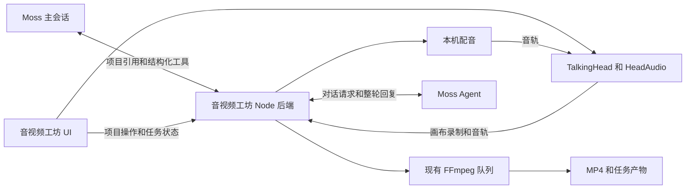

# 音视频工坊 3D 口播与 Moss AI 方案

在 `moss.media-tools` 上升级音视频工坊。把 3D 角色、口播创作、AI 对话和现有 FFmpeg 功能放进同一个 App。角色、素材、任务和产物在同一工作台流转。Apple Silicon 首发。实测基础是 M1 8 GB 上用一套轻量角色完成 36 秒普通话口播，导出 720p / 24 fps MP4。[现有工作台](../apps/media-tools/src/App.tsx) · [市场 App](https://baiguidong.github.io/moss-apps/v1/apps/moss.media-tools.json)

## 功能范围

| 工作区 | 首发功能 | 后续扩展 |
| --- | --- | --- |
| 口播 | 新建和保存项目、输入讲稿或导入配音、选择音色与语速、试听和停播、口型预览、标准字幕、横版和竖版、导出 MP4。按段合成的讲稿可用音频段时长生成字幕时间。配音来源按下文的分发与使用范围选择。 | 编辑字幕文字与时间、角色动作和表情预设、背景图片、分段生成及批量输出。上传音频的自动字幕按需调用语音转写。 |
| 角色库 | 从口播或对话的预览工具栏打开。提供一个可分发角色，支持导入 `.glb`、校验、试播、重命名和设为默认。 | 分角色保存镜头、表情、音色和人设预设，导入与导出项目所需的角色设置。 |
| AI 对话 | 输入文字、角色读出 Moss 的回复、自动播报开关、停止回复与播报、角色人设。可将一条回复复制到口播讲稿。 | 授权麦克风后按住说话，松开后转写并发送。再验证流式回复和语音打断。 |
| 媒体处理 | 选择文件、预览及查看媒体信息，裁剪、压缩、提取 WAV、生成 GIF、转换 MP4。保留现有工具和 CLI 接口。 | 字幕烧录、拼接、批量转换和常用参数预设，逐项扩展结构化操作。 |
| 任务 | 统一显示口播出片和媒体任务，查看进度、取消、失败原因、重试、预览及导出。 | 项目任务历史、批量处理、打包交付。后台渲染在本机引擎通过验证后接入。 |

GLB 导入将文件复制到本 App 的素材目录。校验骨骼、Oculus 口型形变和内嵌纹理，再通过一句本机配音验证预览。角色由本地路径和稳定 ID 管理。当前演示素材可用于验收，正式随包角色需有再分发授权。[TalkingHead 角色格式](https://github.com/met4citizen/TalkingHead) · [HeadAudio](https://github.com/met4citizen/HeadAudio)

## 整体界面

入口用现有「更多 → 音视频工坊」。首屏顶部一行「口播｜对话｜媒体处理｜任务」。使用 Moss 自带外框和主题，正文从当前项目与工具栏开始。设置按钮和角色库入口放在对应操作行。

- **口播**。宽窗口左侧约六成给角色预览，右侧编辑讲稿或配音。预览上沿放角色、画幅和镜头，背景放在设置里。讲稿区标题行放「让 Moss 写讲稿」。音色、语速、字幕集中在讲稿下方。底部同一行放「试听」和主按钮「导出 MP4」。切换为导入配音后，显示音轨与播放控件。导出设置弹层显示画幅、质量和保存位置。
- **对话**。左侧复用同一角色预览，显示待机、思考或播报状态。右侧放聊天列表与输入框。回复末尾可点「用作讲稿」，带到口播，保留原来的对话。麦克风按钮仅在语音方案就绪时可用，发送、停止和静音在同一操作区。
- **媒体处理**。选择媒体后左侧就地预览并显示时长、大小、编码等基本信息。右侧选择处理方式，只展示该方式所需参数。裁剪区间可从当前播放位置设置。输出位置与历史在任务页复用。
- **任务**。一张列表显示名称、类型、状态和输出。选中任务后就地显示日志摘要、预览和可用操作。退出 App 时普通 FFmpeg 任务可由现有队列继续处理，口播画布录制依赖前台渲染窗口。
- **窄窗口**。预览在上、编辑在下。工具栏可换行。长讲稿与对话使用各自区域，主要按钮和错误信息跟随当前任务。浅色和深色跟随宿主设置。[Moss App 布局规范](https://github.com/baiguidong/moss/blob/main/packages/app-sdk/ui-layout.md)

## 与 Moss AI 配合

### 在主会话里做视频

1. 用户在 Moss 会话选择音视频工坊，发送「根据这份产品资料，写一段 30 秒讲稿，做成竖版口播」。Agent 可按当前会话授权读取资料，再调用工作台结构化工具。继续调用时用项目 ID 和版本，沿用当前的角色和配音预设。[App 工具范围](https://github.com/baiguidong/moss/blob/main/ui/docs/app-authoring.md)
2. 工坊创建或更新讲稿、画幅、角色与字幕等项目字段。工具返回项目版本、预计时长、可继续的操作，以及在 Moss 会话打开项目的工作台入口。用户手改讲稿时通过预期版本校验解决冲突。[App 会话工作台](https://github.com/baiguidong/moss/blob/main/ui/docs/app-conversation-workbench.md)
3. 用户同时要求出片时，Agent 提交渲染任务。首发任务可显示「等待打开预览」，打开当前项目工作台即可让可见渲染器接手。已有预览窗口可以直接接手。完成后任务产生本地 MP4 和预览入口，主会话可查询同一个结果。用户也可以从工作台直接提交同一任务。
4. 当只需要传统处理时，主会话继续使用现有 `run`、`task`、`cancel`。例如「把这段视频裁成第 10 到 35 秒，提取音轨」，由 FFmpeg 后端执行并返回产物，复用任务列表。[现有工具清单](../apps/media-tools/app.moss.json#L113)

### 从工作台请 Moss 写讲稿

「让 Moss 写讲稿」通过 `window.mossApp.composer.prepare` 把当前项目引用与修改要求带入 Moss 主会话草稿。嵌入会话时回到同一会话，独立 App 中打开带当前项目的新草稿。发送后由 Agent 读取草稿项目和用户选的资料，再更新同一个项目。参照 HyperFrames 的入口与资源 Provider。[HyperFrames 的主会话入口](../apps/hyperframes/src/ui/main.tsx#L201) · [资源贡献](../apps/hyperframes/app.moss.json#L139)

| 拟开放工具 | 行为与结果 |
| --- | --- |
| 查询工作台能力 | 返回当前可用角色、音色、画幅与导出配置。旧版 `catalog` 可继续查看 FFmpeg 模式。 |
| 新建、读取、更新口播项目 | 用项目 ID、稿件版本和结构化字段保存讲稿及配音设置。返回项目路由和新版本。 |
| 生成本机配音 | 对已保存的稿件版本生成试听音频与段落时长。声音、语速或稿件修改后使用新版本处理。 |
| 提交、查看、取消口播任务 | 提交时固定稿件、角色和画幅，返回任务 ID、进度及工作台入口。成品以文件引用交付。 |

### 和角色直接互动

App 内对话复用 Buddy 的 `moss.agent/v1`。为每个角色对话绑定自己的会话和人设。当用户发送文字时，App 调用 `turn.start`。收到 `turn.completed` 后，把回复交给本机配音，HeadAudio 驱动同一角色。停止时取消当前 Turn 或停止当前音频。角色对话默认使用受限的 App 作用域。需要读取其他 App 或资料时，由用户在主会话按已有选择和授权流程提供上下文。[Buddy 的 Agent 调用](../apps/buddy/src/backend/controller.mjs#L162) · [Agent Host API](https://github.com/baiguidong/moss/blob/main/ui/docs/agent-host-api.md)

按住说话可通过已安装 App 的 `platform:media` 授权采集音频。先复用语音转写的文件转写工具，得到一段文字后再送 Agent。角色渲染、口型、配音、编码在本机。语言模型沿用 Moss 已配置的供应方，完整离线对话另需一套已在目标 Mac 上验收的本机模型。[媒体授权](https://github.com/baiguidong/moss/blob/main/ui/src/apps/app-platform-host.mjs#L246) · [转写工具](../apps/transcription/app.moss.json#L99)

## 实现与交付

- **保留安装身份**。由 `moss.media-tools` 发布新版本，沿用签名市场发布、原 Backend 工具 ID 和已有数据。新口播项目与角色进入独立的数据目录，旧媒体任务继续可读。每个渲染任务固定项目版本和媒体净荷，关闭中的录制标记为中断并可重试。退出或取消后释放 WebGL、AudioContext 和临时文件。
- **本机链路**。Electron 页面使用本地 GLB 和音轨完成口型与录制，Node 后端复用本 App 现有的 FFmpeg/ffprobe 与任务实现。首发采用已实测的画布录制方向，只允许一个角色渲染任务同时占用窗口。长媒体用受控文件或流式接口交接，App 消息只传任务和产物引用。临时实测用的数据串传输需在正式 App 中改成流式。成片经过 H.264/AAC 封装后可以在 Moss 内预览。
- **在线和离线安装**。随包提供渲染依赖、一个授权角色、FFmpeg 和 ffprobe。市场安装与本地导入使用同一份签名 ZIP。当前 `moss.media-tools` Apple Silicon 市场包为 30.22 MiB，合并后基础包预算 **35–45 MiB**，以正式打包为准。升级下载新版合并包。可选语音转写包仍单独复用，Apple Silicon 版约 152.38 MiB。将来可把两份签名包放入离线组合介质一并交付。可选的配音引擎、声库、语音转写和本机大语言模型的体积分别核算。[音视频工坊市场包](https://baiguidong.github.io/moss-apps/v1/apps/moss.media-tools.json) · [语音转写市场包](https://baiguidong.github.io/moss-apps/v1/apps/moss.transcription.json)

### 开源组件与素材授权

- Three.js、TalkingHead 和 HeadAudio 采用 MIT。沿用音视频工坊独立调用的 FFmpeg/ffprobe，核对实际二进制的许可和对应源码。现用 macOS FFmpeg 包启用 GPL。新增工作包括角色导入、项目与任务管理、录制、导出和 Moss Agent 工具适配。自有可重建源码按仓库规范随签名包交付。[TalkingHead 许可](https://github.com/met4citizen/TalkingHead/blob/main/LICENSE) · [HeadAudio 许可](https://github.com/met4citizen/HeadAudio/blob/main/LICENSE) · [FFmpeg 许可文件](../apps/media-tools/assets/licenses/FFmpeg-LICENSE.md) · [源码交付规范](app-source-packaging.md)
- 本机测试用了 macOS 系统音色 Tingting 和 TalkingHead 的演示 GLB。Apple 的 macOS Tahoe 许可将系统语音创作项目限定为个人非商业用途，演示 GLB 采用 CC BY-NC 4.0。商业交付使用有对应授权的角色与配音。用户已有授权配音时可直接导入，商用自动配音可以接 `sherpa-onnx` 和许可明确的中文模型，并按实测更新安装体积与 M1 性能预算。[macOS Tahoe 许可协议](https://www.apple.com/legal/sla/docs/macOSTahoe.pdf) · [演示素材许可](https://github.com/met4citizen/TalkingHead#licenses-and-credits) · [sherpa-onnx 许可](https://github.com/k2-fsa/sherpa-onnx/blob/master/LICENSE)

## 实施顺序与验收

1. **工作台和纯本机出片**。在现有 App 加四个页签与角色库。选择、导入、替换角色后做试听与 720p MP4。先验收一段约 10 秒和一段约 36 秒普通话。测字幕和音轨同步、M1 内存、低负载模式和长稿行为。检查原媒体任务、CLI 和已有记录可用。
2. **Moss 创作与文字互动**。实现项目资源引用及结构化工具。分别验证从主会话发起、从工作台发起、重复修改同一讲稿以及回到项目预览。验证角色朗读、停止和将回复转为讲稿。
3. **语音与进一步自动化**。验证按住说话和授权撤销、语音转写可选安装、外部会话工具范围。评估流式回答及后台渲染。对 16:9、9:16、窄窗和浅深主题做正式 App 内验收，在断公网时做本机口播与导出验证。
