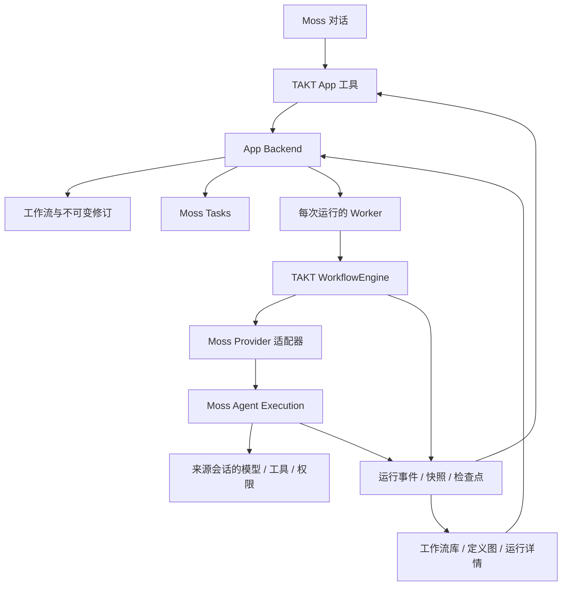

# TAKT 工作流 App 规划

日期：2026-10-14。状态：本次 Moss 集成范围已实现，`moss.takt@0.2.2` 已安装并完成真实桌面和模型测试。交付与证据见 [交付记录](takt-app-delivery.md)。以下保留原设计依据，实际能力及限制以交付记录为准。调研基线：`takt@0.70.0` 发布包与当前 Moss 源码。

## 目标与决策

新增独立 App `moss.takt`，显示名「TAKT 工作流」，与现有 `moss.workflow` 并存。安装后在本地创建和运行工作流，通过 Moss 对话操作，并在 App 内查看流程图、运行进度、节点结果和历史。

用户已选择：Agent 步骤复用 Moss 当前会话的模型、工具和权限。App 不要求用户维护单独的工作流平台、安装全局 TAKT/Claude Code/Codex CLI，或配置另一份模型密钥。运行时和依赖由安装包及 Moss 管理；模型和外部工具仍使用 Moss 原有连接。

采用 **TAKT 引擎 + Moss 执行适配器 + Moss App UI**。TAKT 负责流程语义、条件、循环和调度；Moss 负责 Agent 执行、授权、预算与任务生命周期；App 保存定义、修订和运行记录，并展示图。

## MCP 与 UI 的边界

MCP 可以承载创建、执行、查询等工具接口；`stdio` 只是传输方式，不代表需要用户另行部署平台。Moss 可以负责本地进程的启动和回收。普通 MCP 工具接入本身不会生成适合 Moss 的流程编辑、运行图和历史界面。

| 接入方式 | 已有能力 | 本需求仍需的工作 |
| --- | --- | --- |
| 官方 `takt-mcp` | 入队、任务列表、运行查询、追加指令 | 工作流创作接口、实际 runner、Moss 执行适配、图与历史 UI |
| 托管 `takt ui` | 本地 Web UI、执行图、任务管理及自动启动 worker | 适配 Moss 模型和授权、App 生命周期、中文和主题；原有对话、provider、worktree/PR 流程与 Moss 存在重叠 |
| 程序化引擎 + Moss App | 可保留 TAKT 调度并接入 Moss 原生任务 | 实现执行适配、数据存储、工具和 UI；最符合本次需求 |

首版直接提供 Moss App 原生工具，调用同一 Backend 服务。若以后需要 Claude Code 等外部客户端控制这个 App，可以再增加 MCP 门面；外部入口必须有明确的 Moss 会话绑定，不能只凭本地连接就继承任意会话权限。

TAKT 0.70.0 **已有实验性 Web UI**。包内 `execution-model.js` 和 `execution-map.js` 提供逻辑节点、执行次数、循环、并行组及调用关系的处理和渲染。优先验证这些模块的复用性，并适配中文、Moss 主题和 App bridge。其内部数据格式尚非稳定 SDK，需固定版本和测试。无需预设整套图必须从零实现，也不直接搬入其任务与 provider 后端。

## 已确认的技术基础与缺口

| 项目 | 调研事实 | 规划影响 |
| --- | --- | --- |
| 引擎 | 根包公开导出 `WorkflowEngine`、配置加载器及事件类型；有 `run`、`abort`、`getState`、`getResumePoint` 等方法 | 可程序化运行，不依赖解析 CLI 文本输出 |
| Provider | 当前注册表固定内置 providers，无公开的任意 Provider 注册入口；类型和能力声明也有限定 | 单加 `provider: moss` 不会生效；需要固定版本的源码补丁或注入接口 |
| 模型调用 | 普通步骤及报告等经过 Provider；部分判断/分解支持 `structuredCaller` 注入 | 仅注入 `structuredCaller` 无法覆盖全部 Agent 调用 |
| 图事件 | 有步骤、阶段、路由、并行/子工作流相关事件 | 定义生成结构，事件覆盖实际路径；不从自然语言日志猜图 |
| 恢复 | 有 resume point 和会话恢复参数，但恢复并不等同于完整进程状态重建 | 必须验证步骤输出、并行上下文和检查点边界 |
| 运行时 | TAKT 要求 Node `>=22.22.0`；调研时 Moss 受管 Node 为 `22.22.2` | 版本条件匹配，仍需实测最终打包的依赖闭包 |
| 许可与体积 | TAKT 为 MIT，发布包含多个 provider SDK 和 CLI/Web UI 资源 | 保留许可及来源；不能假设只 import 根包就自动排除无关依赖 |

## 架构

- 使用普通 UI + persistent Node Backend App，目录建议为 `apps/takt/`；分类 `automation`，入口放「更多」，默认 `toolScope: session`。
- Backend 拥有目录、任务登记、事件存储与 Host 调用；运行 Worker 隔离 TAKT 的全局 registry/config 状态，经 Backend 请求 Host 执行。
- 一个 TAKT run 对应一个 Host task；其中每一次 Agent 调用对应一个 Host execution。App 自己的 `runId` 保持稳定，记录 task attempt 和 execution 关系。
- 图和工具读取同一份运行事实。UI 不承担调度，关闭页面后后台继续执行；退出 Moss、停用 App 等按 Host 生命周期中断或取消。
- 保持现有工作流定义与数据独立。可参考其运行登记、资源、取消和恢复实现，不将 Definition v3 转成新的通用中间语言，不另写一套 TAKT 调度器。

## 对话与页面体验

### 对话操作

示例：「创建一个需求分析 → 实现 → 两路审查 → 汇总的流程，审查失败时返工，最多三轮。」

1. Moss 使用 App 提供的创作说明和 schema 生成 TAKT 定义，通过 Backend 校验后保存。
2. 返回名称、修订、流程摘要和打开图的入口；用户无需在对话里手写 YAML。
3. 「增加一个测试步骤」基于当前修订编辑并返回变化摘要；冲突时重新读取，不覆盖新版本。
4. 「用这个流程处理当前项目」创建后台 run，立即返回任务卡片和运行详情入口。
5. 「现在进行到哪一步」读取真实状态，回答当前节点、阶段、轮次和已有结果。
6. 「停止」「重跑」「补充这一轮要求」分别调用明确的控制操作。

用户明确说「创建并运行」时可以连续完成保存、校验和运行。仅创建、选择资源或打开 App 不启动执行。普通授权继续沿用 Moss，不叠加无意义的 App 二次确认。

### App 页面

| 页面 | 首版内容 |
| --- | --- |
| 工作流库 | 名称、说明、最新修订、最近运行；搜索、新建、复制、导入/导出 |
| 工作流详情 | 定义图、节点角色与指令、转移条件、循环上限、校验结果、修订记录；高级 YAML 编辑 |
| 运行详情 | 当前状态与耗时、实际执行图、轮次/并行分支、事件时间线、取消与重跑 |
| 节点详情 | 本次执行使用的指令与可用输入、输出、错误、阶段、耗时及 Host 提供的统计 |
| 运行历史 | 按工作流和状态筛选；打开对应修订及当时的执行路径 |

运行详情以图为主体，节点详情放侧栏，时间线辅助定位。提供缩放、平移、适应画布、跟随当前节点和切换某次执行；兼容中文、浅色/深色及窄窗口。

首版图用于预览和观察；结构编辑通过对话或 YAML 完成。拖动节点只保存布局。拖线改条件、完整可视化编排编辑器后续再做，避免同时维护两套定义语义。

## 定义、版本与工具

### 定义模型

以 TAKT YAML 和它解析后的快照为准，另存 App 元信息：`workflowId`、名称、描述、`revision`、引擎版本、来源与校验结果。每次成功保存形成不可变修订；run 固定引用该修订及依赖快照，运行中编辑不会改变已经提交的流程。

persona、指令、报告模板和子工作流引用必须解析到受管 bundle，保存内容及校验值。导入校验路径边界、缺失依赖和支持的特性；禁止默默回退到用户 `~/.takt` 或项目中的另一份配置。导出的 TAKT bundle 应说明 Moss 特定执行能力与适用版本。

### 工具契约草案

| 工具 | 用途 | 效果 |
| --- | --- | --- |
| `takt_read` | 分页读取目录、定义、修订、运行、事件和分块结果 | read |
| `takt_create` | 创建、导入或复制工作流 | write |
| `takt_edit` | 带 `baseRevision` 编辑定义或元信息 | write |
| `takt_validate` | 解析并返回带字段位置的诊断、能力与预算限制 | read；不执行工作流 |
| `takt_run` | 提交指定修订，返回 `runId`、状态与详情入口 | write |
| `takt_control` | 取消、补充输入、重跑及符合条件的恢复 | write |

归档可后续增加明确的 destructive 工具；首版无需永久删除接口。所有工具声明严格 schema，限制文本和列表大小。大输出保存为 App 资源并分块读取，运行查询不把整份历史塞进模型上下文。

通过 resource provider 暴露工作流和 run 引用，便于在 Moss 会话中选择。工具说明携带简洁的 TAKT 创作指南和合法示例；生成仍由当前 Moss 对话完成，无需再启动一个独立生成 Agent。

## Moss 执行适配

### Provider 接口与调用覆盖

优先为固定版本 TAKT 增加一个窄的 Provider factory/注入入口，同时处理 Provider 类型校验和能力声明。补丁单独保存并可重复应用；保留引擎调度语义，不运行时改写已安装包，不借用 `mock` 冒充 Moss Provider。

Provider 的调用通过 `createExecutionClient` 发起，按需读取完整结果，转换为 TAKT 的状态、文本、结构化输出、会话标识、usage 和错误。普通执行、报告、评判、分解及并行步骤全部纳入审计；某条调用路径尚未适配时，在校验阶段禁用对应特性。

`structuredCaller` 同样接入 Moss，覆盖它所负责的内部调用。交付条件包括：不会因默认值、配置继承或错误回退而启动外部 provider SDK/CLI。

### 会话、权限与结果

- 从主会话工具启动时，`task.create` 由 Host 绑定来源会话、工作区和权限，返回 `scopeRef`；后续 execution 使用它。App 不接受调用方伪造 scope。
- 从 App 窗口启动时，Host 按现有规则创建普通本地会话，使用默认模型/权限/工作区，并让用户能进入该会话查看授权。不能宣称自动继承任意当前窗口背后的会话。
- `execution.start` 没有直接的 model 或 systemPrompt 参数。默认沿用 Moss 会话配置；TAKT persona、任务和输出约束按结构拼入任务 prompt，不能覆盖 Host 的权限规则。
- Host 过滤递归 Agent/Team/SendMessage 及调用 App 自身的工具，`resources.tools` 只能进一步缩小工具范围。导入的 TAKT 工具名称必须映射到 Host 实际可用工具；不支持的权限模式或工具配置返回诊断。
- 结构化输出使用 `outputSchema`；普通文本可通过约定的结果 envelope 转换。适配器校验结果，再交给 TAKT 做路由判断，避免误把 schema 失败当作成功。
- TAKT 会话标识映射为 Moss `contextKey`。同一逻辑 Agent 需要延续时复用；独立角色、并行分支或明确 fresh execution 使用不同 key。映射和 Host execution ID 一并持久化。
- Host 没有公开的任意 session compact 接口。需要精确压缩/恢复语义的特性先校验或限制，不伪造等价实现。

### 边界、取消与预算

Agent 使用 Moss 工具时由 Moss 处理实际工具授权。TAKT 自身直接执行的 shell quality gate、system step、worktree、git 或自动 PR 不会天然经过这层授权；首版在定义校验时拒绝这些未适配能力。后续逐项接入受授权的 Host 能力后开放，不能靠提示词保证隔离。

使用 `ExecutionWatcher`、`TaskChangesWatcher` 订阅状态，同时查询最终状态做对账。取消需要同时停止 TAKT 后续调度和所有进行中的 Host executions；处理取消与完成竞争，最终状态不被晚到事件覆盖。

当前 Host 契约上限为并发 16、调用 256 次、时长 30 分钟、token 200 万。App 可以设更小默认值；所有隐含评判/报告调用都计入同一个 task。循环与并行还需各自的有限上限。超限形成可解释的结束状态，不能重建 task 绕过预算。

## 状态、进度与图

分开存储定义图和实际执行次数。逻辑节点使用稳定标识；一次执行还要包含轮次、阶段、调用栈和并行参与标识，避免一次循环完成把后续迭代错误涂成完成。

实施核对后，工作流边来自实际相邻的顶层 `step:start` 与完成终态；`routing:decision` 是模型自动路由事件，不能当作流程转移。节点和阶段来自 `step:start/complete`、`phase:start/complete` 等实际引擎事件，并行子结果从引擎状态读取。Host execution 提供运行、结果、取消等事实；App 保留来源标识和序号。

| 展示项 | 口径 |
| --- | --- |
| 当前进度 | 当前节点、阶段、轮次、完成执行次数、并行分支状态及耗时 |
| 百分比 | 仅在分母有明确且稳定含义时显示；循环或动态展开流程使用实际计数，不编造百分比 |
| 节点输出 | Host 最终结果和 TAKT 报告，按次查看；保存必要副本避免 Host 结果过期后丢失历史 |
| 实时工具信息 | 只展示公开契约提供的 token/toolCalls/lastToolName 等信息 |
| 等待输入 | TAKT 确实提出问题时显示问题及输入入口，等待消耗任务总时长；Host task 此时仍为 running |
| 授权 | 沿用 Moss 原生授权界面；当前 execution 契约没有 `waiting_permission` 状态 |

当前 Host 不公开逐 token 文本、完整工具参数/结果流或思考过程。首版不承诺完整实时 Agent transcript；如以后需要更细粒度追踪，作为通用 Host 能力扩展另行设计。

上游图复用验证应覆盖：定义尚未运行、重复访问节点、并行组、子工作流和缺失事件。若其模型过于依赖中央 task 存储，则保留 App 统一运行模型并使用 Moss 已有画布技术渲染；图组件替换不影响 Backend 契约。

## 持久化、幂等与恢复

首版使用 App 私有目录中的定义 bundle、JSON 快照、追加 JSONL 事件和结果文件，不引入数据库服务。快照原子替换，日志有版本与单写入方；目录索引损坏时可由元信息重建。

- 在调用 `task.create` 前持久化提交意图、输入指纹和提交键；请求超时后用同一键核对，避免重复 run。
- 每次 Agent 派发前登记稳定执行键。真正重跑产生新 run/attempt；传输层重试使用原键，不重复副作用。
- 保存定义依赖快照、引擎版本、session/context 映射、节点结果、检查点及 App 事件。Host 历史有保留和数量限制，不能替代 App 历史。
- 页面关闭只断开订阅；重新打开由快照加增量恢复视图。事件丢失或重复时查询并对账；无法重建的细节标记缺口，不补造日志。
- Backend/Moss 重启后先与 Host 对账，将失去执行能力的 run 标记 interrupted，不自动从头执行。
- 「重跑」新建运行；「恢复」只对已验证的步骤边界开放，并关联原运行和检查点。恢复 Host task 后使用新的 `scopeRef` 与 attempt。
- TAKT resume point 不保证保存所有 `stepOutputs`；必须验证并补齐恢复所需状态。进行中的并行步骤或副作用状态不明时不给出无损恢复承诺，不自动重放。

## 首版范围与后续扩展

首版支持经过适配验证的 Agent 步骤、显式条件转移、有限循环、静态并行、结构化结果、保存与修订、对话执行、实时图、节点结果、取消、历史和重跑。TAKT 子工作流、交互输入和安全边界恢复在 P0 分别验证，通过后进入首版。

后续扩展：画布结构编辑、定时触发、外部 MCP 控制入口、动态团队/Companion、精确 session 压缩、跨来源配置导入，以及 direct command/git 等副作用能力。模板和可用工具只展示已经支持的特性。

## 安装包与维护

固定 TAKT 版本、补丁和依赖锁；包内包含完整可重建源码、构建脚本、SDK 来源和许可证。构建阶段解析所需依赖，交付时验证在隔离环境直接运行，不依赖开发机的 `node_modules`、全局 CLI 或用户 `~/.takt`。

Backend 启动只做必要初始化，不能阻塞 App 握手。运行由 Moss 受管 Node 启动；首版无需开放 localhost Web 服务端口。平台相关资源必须按目标平台验证，不将未经验证的平台标为支持。

升级前验证 schema/数据迁移并保留恢复路径。旧运行保留引擎与 adapter 版本信息；不使用新引擎直接恢复尚未确认兼容的旧检查点。

## 实施顺序与验收门槛

| 阶段 | 交付物 | 完成条件 |
| --- | --- | --- |
| P0 执行兼容验证 | 最小 Provider 补丁与 Moss 适配试验；上游图复用结论；特性兼容表 | 真正通过 Moss 执行单步、条件循环、静态并行和报告/评判；所有模型调用可核对，取消有效；说明恢复与子工作流的已验证边界 |
| P1 创作与目录 | Manifest、工作流库、schema、修订、工具、资源引用、导入/导出 | 在 Moss 对话创建/修改定义并预览图；非法定义不能提交运行，旧修订不被改写 |
| P2 运行与图 | Worker、Host task/execution、事件桥接、运行图与节点详情 | 对话提交后后台运行；图与实际分支/轮次一致，能查状态、结果并停止 |
| P3 历史与恢复 | 日志、快照、结果资源、幂等、重启对账及已验证恢复能力 | 关闭页面不中断；重复提交不重复执行；重启有明确状态；未知副作用不自动重放 |
| P4 独立交付 | 可安装 ZIP、说明、兼容性与测试记录 | 干净环境安装后直接使用；真实 Moss 链路和各声明平台验证通过；现有 Workflow 正常 |

P0 是关键依赖，应先完成再投入完整 UI。若需要补 Host API，只增加通用执行能力并记录最小 Host 版本；不把 TAKT 特定图语义塞进 Moss Core。

最终验收场景：

1. 只安装 App，通过 Moss 对话生成流程、编辑修订、启动运行并查看图；无额外平台和模型密钥配置。
2. 运行「分析 → 实现 → 并行审查 → 汇总」，审查失败触发有限返工；图显示每一次访问与真实路由。
3. 普通步骤、评判、报告全部使用 Moss，受同一预算和工具权限约束；拒绝授权后得到真实失败/取消信息。
4. 并行执行角色上下文不会串扰，需要延续的节点保留符合 TAKT 语义的上下文。
5. 网络/IPC 超时重试不重复提交或派发；同键不同输入返回冲突。
6. 取消、预算耗尽、模型失败和关闭 Moss 都停止后续调度，并保留可理解的状态与结果。
7. 关闭再打开 App 可以继续查看进度；重启后核对实际状态；仅对验证过的检查点提供恢复。
8. 编辑工作流后，旧 run 仍显示当时的定义和输出；大结果分页或分块读取。
9. 不支持的 provider、脚本、路径或依赖在运行前得到明确诊断，不回退到外部 CLI 或静默忽略。
10. 安装包在没有开发依赖的环境可用，中文/主题/窄窗口和卸载停用生命周期通过验证，现有工作流数据与行为保持独立。

## 参考与调研限制

- [TAKT 项目](https://github.com/nrslib/takt)、[0.70.0 发布包](https://www.npmjs.com/package/takt/v/0.70.0)、[官方 MCP 说明](https://github.com/nrslib/takt/blob/main/docs/cli-reference.md#mcp-server)、[Web UI 源码](https://github.com/nrslib/takt/tree/main/web-ui)。GitHub main 会变化，实施以固定版本为准。
- 发布包核对文件：`dist/index.d.ts`、`dist/core/workflow/types.d.ts`、`dist/infra/providers/index.js`、`dist/shared/types/provider.d.ts`、`dist/core/models/workflow-resume-schema.d.ts`、`web-ui/README.md`、`web-ui/public/execution-model.d.ts` 和 `execution-map.d.ts`。
- [Moss App 创建规范](../../moss/ui/docs/app-authoring.md)、[执行 Host](../../moss/ui/docs/app-execution-host.md)、[实际执行契约](../../moss/packages/host-contracts/src/execution.mjs)、[SDK](../../moss/packages/app-sdk/README.md)、[源码打包规范](app-source-packaging.md)。接口细节以实际契约为准；当前 SDK 基线为 3.11.0，最终 Manifest 下限由实际用到的能力决定。
- [现有 Workflow App](../apps/workflow/README.md)、[运行管理](../apps/workflow/src/backend/runs.ts)。仅复用通用集成经验。

实施结果：P0 已验证固定 Provider/runner 适配与真实引擎调用，图采用 Moss 已有 ReactFlow 技术；P1/P2 已完成对话创作、修订、执行和状态展示；P3 已完成历史、固定修订、幂等、取消及重启终止对账，同进程暂停可继续，跨进程检查点恢复仍延期；P4 已在实际 macOS Apple Silicon 开发版 Moss 安装并测试。子工作流、其他平台、拖线编辑、定时和外部 MCP 控制入口未宣称完成。详见 [交付记录](takt-app-delivery.md)。
